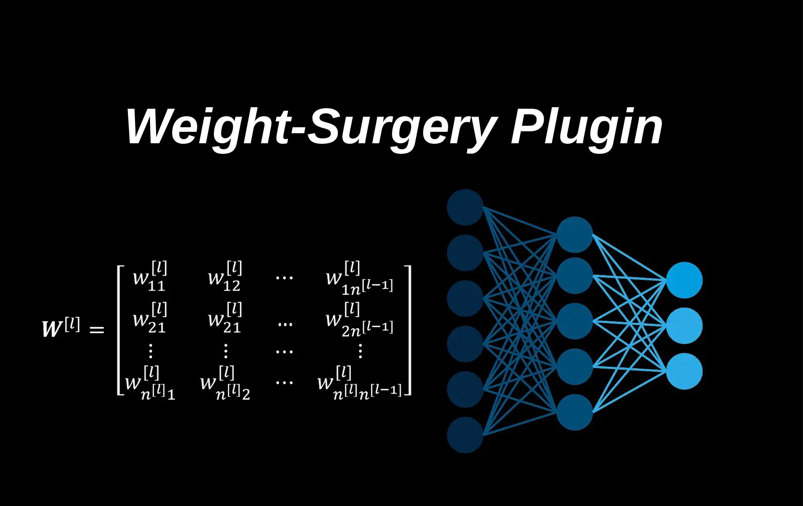

# Weight Surgery Skill



**Find the exact weights behind a behaviour in a trained transformer, and change them directly, with no training.**

This is a plugin for Claude Code with one skill: instructions (`SKILL.md`), reference
notes and a Python toolkit. With it, Claude can help you find which attention heads, neurons or directions inside a
language model cause a behaviour you don't want, for example the model getting stuck repeating itself, and then edit
those weights by hand. The Python file also works on its own, without Claude.

## Why would I want this?

The usual way to change how a model behaves is to train it more. That is slow, needs data, and can break other
things. But sometimes the behaviour you want gone lives in a small part of the network that you can actually find. If
you find it, you can turn it down or cut it out directly, and see right away what that does.

This skill gives you a careful, step-by-step way to do that, and to stay honest about whether it really worked.

## What it can do

- **Find the suspects.** Scan the attention heads for "copy heads" (the kind that make a model repeat what it already
  wrote), switch heads off one at a time to see what breaks, and find which neurons push the model toward the
  behaviour.
- **Tell two jobs apart.** One head often does a good job and a bad job at the same time. In the worked example, the
  head that caused loops also copied names from the question into the answer. The tools find the directions inside the
  head (patterns across its numbers) that carry mostly the bad job, so you can cut those and keep the rest.
- **Edit safely.** Turn a head down or off, cut a few directions out of it, or remove what a layer writes along one
  direction. Every edit can be undone exactly, bit for bit.
- **Test fairly.** Each candidate edit is applied, measured on the same fixed test rows, undone, and logged. A random
  edit of the same size serves as a control, so you can tell a real effect from luck.
- **Let real output decide.** Quick test numbers can move while the model writes no better than before. The method
  makes generation on fresh prompts the final judge.
- **Save without risk.** The chosen edit is saved as a new file. The original is never touched, the new file is
  checked, a manifest lists every change, and an undo file rebuilds the original exactly.

## What it can't do

It can't teach a model anything new. If the problem sits in the parts that *build* an ability (for example the first
layers that put the right next word on top), there is nothing to cut: that needs training, and the method tells you
when you have reached that point.

Also, many edits that look good on a small test vanish on a bigger, fresh one. The method is built to catch that,
not to hide it.

## Install

**As a Claude Code plugin,** one command in your terminal:

```
claude plugin install weight-surgery --marketplace achelousace/weight-surgery
```

or inside Claude Code:

```
/plugin install weight-surgery --marketplace achelousace/weight-surgery
```

This needs Claude Code 2.1.275 or later. On older versions, add the marketplace first, then install:

```
claude plugin marketplace add achelousace/weight-surgery
claude plugin install weight-surgery@weight-surgery
```

Restart Claude Code if it is running. It uses the skill when you ask things like "which head causes the loops?",
"switch off this head", "remove this direction from the weights", or "wsp".

**By hand:** copy the `skills/weight-surgery` folder into `~/.claude/skills/` (for all your projects) or into
`.claude/skills/` inside one project.

**On its own:** `skills/weight-surgery/scripts/surgery.py` is a normal Python module.

```python
import sys
sys.path.insert(0, "path/to/weight-surgery/skills/weight-surgery/scripts")
import surgery as su
```

You need Python 3 and PyTorch 2 (the attention tools use PyTorch's `scaled_dot_product_attention`). Install
`safetensors` as well if your checkpoints use that format; the self-test uses it too. Tested with Python 3.13,
PyTorch 2.11 and safetensors 0.8.

## Check that it works

```
python skills/weight-surgery/scripts/surgery.py --selfcheck
```

This trains a tiny transformer on your CPU. It learns to copy, and grows a real copy head while doing so. Then every
tool is tried on it: edits and their exact undo, the direction tools, the attention tools, the probes, and a full
save-and-undo cycle in both `.pt` and `.safetensors` files. It took 16 seconds on the computer it was tested on, and it
ends with `selfcheck passed`.

## The method, step by step

0. **Say exactly what is wrong, and what must survive.** For example: "a loop starts when the same 4 tokens show up a
   third time", and "reading answers must stay as good as they are".
1. **Measure where you start, and how noisy your numbers are.** Small changes on small test sets are often just luck.
2. **Find the parts that carry the behaviour:** heads, neurons, or directions in what a layer writes.
3. **Inside a part, separate the bad job from the good one** if it does both.
4. **Make reversible edits:** turn something down, cut it out, or remove one direction.
5. **Screen every candidate:** try a range of strengths (a real effect grows with the dose) and a random control
   (which should do nothing).
6. **Let real generation decide,** on fresh prompts, with enough of them, comparing like with like.
7. **Keep, drop, or stop.** If nothing moves real output, or the part turns out to be essential, stop editing.
8. **Save the winner as a new file,** with a manifest and an undo file.

`skills/weight-surgery/SKILL.md` explains each step, and `skills/weight-surgery/references/methods.md` gives every
detail.

## A small example

```python
import torch
from transformers import AutoModelForCausalLM
import surgery as su

model = AutoModelForCausalLM.from_pretrained("your-model", torch_dtype=torch.float32,
                                             attn_implementation="sdpa").eval()
hd = model.config.hidden_size // model.config.num_attention_heads      # size of one head
fwd = lambda m, ids: m(torch.tensor([ids]))

# 1. Which heads copy? Feed a few texts that repeat themselves (lists of token ids).
scores = su.induction_scan(model, fwd, repetitive_texts)

# 2. Switch head 0 of layer 4 off, measure, and put it back exactly.
S = su.Surgeon(model)
head_off = [dict(op="scale", param="model.layers.4.self_attn.o_proj.weight", cols=[0, hd], factor=0.0)]
with S.trial(head_off):
    print(my_tests(model))      # your own fixed test rows
S.check_restored()              # the weights are back, bit for bit

# 3. Keep the edit and save it as a NEW file, with a manifest and an undo file.
S.apply(head_off)
su.save_edited(model, "model.safetensors", "edits/layer4_head0_off.safetensors", head_off, S, state_key=None)
```

`repetitive_texts` and `my_tests` are yours to write; `skills/weight-surgery/references/methods.md` shows how to build
good ones.

## What's in the folder

- `.claude-plugin/`: the plugin and marketplace manifests that make the install commands work.
- `skills/weight-surgery/SKILL.md`: the instructions Claude follows, with the full method, the rules learned the hard
  way, and how to report results.
- `skills/weight-surgery/references/methods.md`: every step in detail: how to build the test data, the exact formulas,
  where heads and neurons live in common model families (Llama, Mistral, Qwen, Gemma, GPT-2), and a list of bugs to
  avoid.
- `skills/weight-surgery/references/cases.md`: a worked example on a small chat model, with real numbers: what worked,
  what didn't, and why.
- `skills/weight-surgery/scripts/surgery.py`: the toolkit, with its built-in self-test.

## Habits the method insists on

- Never write over the original model file.
- Test on prompts the model has never seen, and enough of them: in the worked example, every win on 40 prompts
  vanished on 120.
- Compare every edit against a random edit of the same size.
- Remove a direction from the weights that write it, not from the signal flowing through the model. Removing it from
  the signal broke the model in the worked example; removing it from the weights cost almost nothing.
- Read the actual numbers, not a summary of them.
